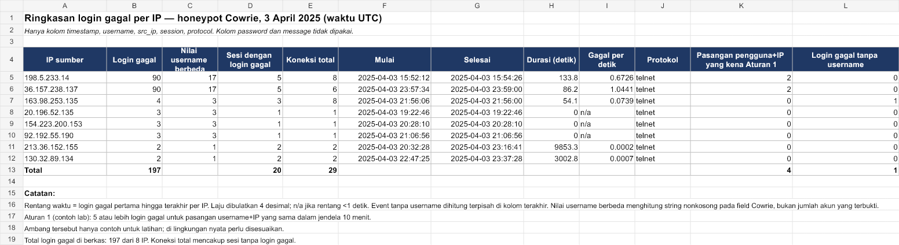

# SOC Log Detection Lab

Proyek portofolio blue-team untuk menganalisis pola login gagal dengan Python dan data log Cowrie. Analisisnya pasif: proyek membaca log yang sudah ada, bukan menyerang atau menguji sistem pihak lain.

## Tujuan

Menunjukkan alur dasar kerja analis SOC: membaca log, menormalkan field yang relevan, menerapkan aturan deteksi sederhana, lalu menulis penilaian yang memisahkan fakta dari dugaan.

## Aturan deteksi

1. **Login berulang per akun dan IP:** 5 atau lebih kegagalan untuk pasangan username dan alamat sumber yang sama dalam jendela 10 menit.
2. **Login berhasil setelah kegagalan:** jika login berhasil terjadi dalam 2 menit setelah kegagalan terakhir pada pasangan yang sudah memicu Aturan 1, keluarkan eskalasi untuk ditinjau.
3. **Kandidat password spraying:** satu alamat sumber mencoba 5 atau lebih nilai username berbeda dalam jendela 10 menit. Ini kandidat investigasi, bukan bukti serangan.

Ambang di atas hanya parameter latihan. Nilai untuk sistem produksi harus mengikuti kebijakan dan pola normal organisasi.

## Hasil utama

- Berkas Cowrie satu hari berisi 669 event: 197 login gagal, 236 koneksi, dan 236 sesi ditutup.
- Ada 8 alamat sumber yang memiliki login gagal dan 106 alamat yang hanya tercatat terhubung.
- Dua sumber teratas masing-masing mencatat 90 kegagalan dalam 5 sesi dan 17 nilai username berbeda. Polanya memicu Aturan 1 untuk nilai root dan admin, serta Aturan 3 sebagai kandidat.
- Tidak ada event login berhasil dalam berkas Cowrie ini. Aturan 2 karena itu tidak dapat diuji pada data tersebut; contoh sintetis di data/sample_log.csv menunjukkan eskalasi setelah login berhasil.
- Pada 163.98.253.135 terdapat 4 kegagalan: 3 nilai username terisi dan 1 event tanpa username. Sebagian nilai field username di log dapat berupa teks protokol, jadi tidak semuanya dapat dianggap nama akun.

## Ringkasan workbook

Workbook memisahkan nilai username terisi dari event tanpa username. Laju kegagalan ditampilkan sampai 4 angka desimal agar laju yang sangat kecil tidak tampak sebagai nol.



[Buka workbook ringkasan](outputs/cowrie-portfolio/cowrie-login-summary-portfolio.xlsx) · [Baca studi kasus](docs/portfolio-case-study.md) · [Baca analisis teknis](docs/cowrie-analysis.md)

## Menjalankan proyek

Proyek menggunakan pustaka standar Python; tidak ada paket tambahan yang diperlukan.

```powershell
python read_logs.py
python count_failed_logins.py
python detect_logins.py
```

Untuk mengulang analisis Cowrie:

1. Unduh file cowrie.json.2025-04-03.anon dari [record Salty Seagull di Zenodo](https://zenodo.org/records/18088113).
2. Simpan file tersebut di folder data proyek dengan nama yang sama.
3. Jalankan:

```powershell
python normalize_cowrie.py
python detect_logins.py data/cowrie_login_events.csv
```

Normalizer mempertahankan timestamp, username, source IP, dan jenis event autentikasi. Field password dan message tidak disalin ke CSV hasil normalisasi atau dipakai aturan deteksi. Satu event tanpa username dilewati untuk analisis per akun dan dicatat sebagai data tidak lengkap.

## Sumber data dan batasan

Dataset Salty Seagull berasal dari interaksi ke honeynet Cowrie. Alamat IP di file sumber telah dianonimkan. Username adalah nilai yang dicoba pada honeypot, bukan akun pengguna produksi. Dataset README meminta sitasi terhadap paper Salty Seagull; file log mentah tidak disertakan di repositori ini.

- [Record dataset Salty Seagull](https://zenodo.org/records/18088113)
- [README dan petunjuk sitasi dataset](https://zenodo.org/records/18088113/preview/README.md?include_deleted=0)
- Makrakis, G. M., Pijpker, J., Hassing, R., Loves, R., & McCombie, S. (2025). Salty Seagull: A VSAT Honeynet to Follow the Bread Crumb of Attacks in Ship Networks. [arXiv:2508.11325](https://arxiv.org/abs/2508.11325).

Analisis hanya mencakup satu hari, tidak mempunyai event login berhasil, dan tidak mengidentifikasi pelaku atau niatnya. Ketiadaan alert bukan bukti bahwa aktivitas aman; aturan ini hanya mencakup pola yang didefinisikan di atas.

## Project 2 — Analisis PowerShell ter-encode dengan Splunk

Latihan investigasi SOC memakai log Sysmon simulasi dari Splunk Attack Data. Kita mengatur ingest, memvalidasi event, mencari `-EncodedCommand`, menelusuri parent process, dan menghubungkan DNS dengan koneksi jaringan. Dataset mentah dan payload Base64 tidak disalin ke repositori.

- [Laporan dan panduan langkah demi langkah](projects/splunk-powershell-obfuscation/LAPORAN.md)
- [Query Splunk](projects/splunk-powershell-obfuscation/splunk-queries.md)
- [Ringkasan proyek](projects/splunk-powershell-obfuscation/README.md)

